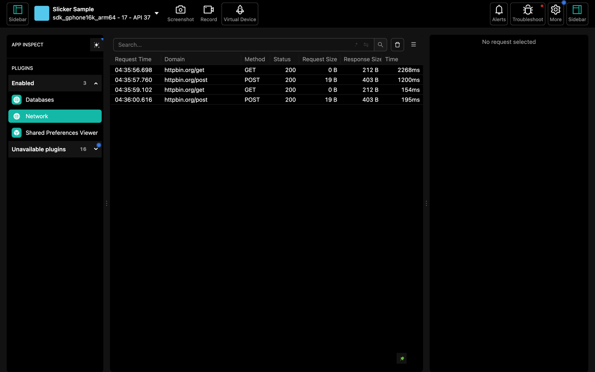
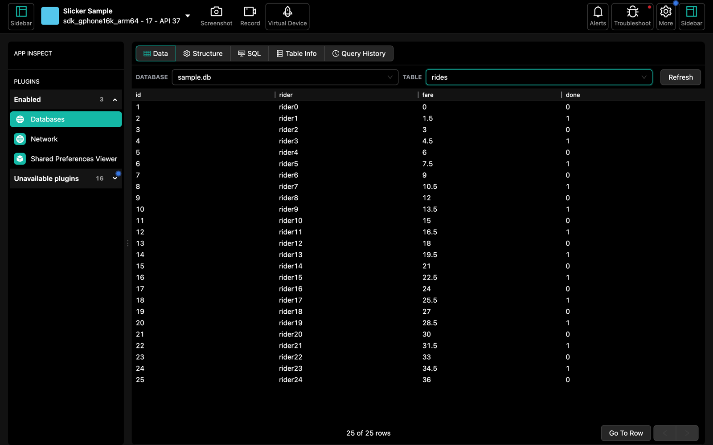
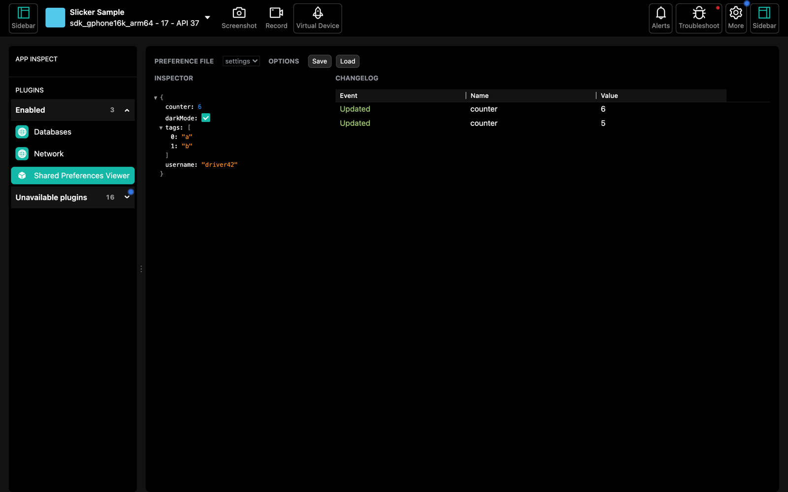

<p align="center">
  
</p>
<h1 align="center">Slicker</h1>
<p align="center">
  Network, database and preferences inspector for Android apps, in one desktop window.
</p>
<p align="center">
  <a href="https://jitpack.io/#yehiahd/slicker"></a>
</p>

---

Slicker is a lightweight debugging tool for Android. Your debug build connects to a desktop app
running in your browser, where you can inspect:

| Plugin | What you see |
|---|---|
| **Network** | Every OkHttp request and response: URL, method, status, headers, bodies, timing |
| **Databases** | All SQLite/Room databases: browse tables, structure, run SQL |
| **Shared Preferences** | All SharedPreferences files: view, edit, delete, live change log |

The Android library is pure Kotlin (no C++ or NDK) and needs no certificate setup. Release builds use
a no-op artifact, so nothing ships to users.

## Screenshots

**Network**: every request and response from OkHttp



**Databases**: browse tables and run SQL



**Shared Preferences**: values and a live change log



## Quick start

**1. Start the desktop** (needs `adb` and Node or `npx`):

```bash
./scripts/slicker-desktop.sh
```

It opens http://localhost:52342. The first run builds the desktop and takes a few minutes.

**2. Add the library** to your app:

```kotlin
// settings.gradle.kts
dependencyResolutionManagement {
    repositories {
        google()
        mavenCentral()
        maven("https://jitpack.io")
    }
}

// app/build.gradle.kts
dependencies {
    debugImplementation("com.github.yehiahd.slicker:slicker:v0.1.0")
    releaseImplementation("com.github.yehiahd.slicker:slicker-noop:v0.1.0")
}
```

**3. Start it** in your `Application`, and add the interceptor to your `OkHttpClient`:

```kotlin
class MyApp : Application() {
    override fun onCreate() {
        super.onCreate()
        Slicker.start(this)
    }
}

val client = OkHttpClient.Builder()
    .addInterceptor(Slicker.networkInterceptor())
    .build()
```

**4. Run** your debug app on an emulator or USB device, pick it in the desktop, and enable the
plugins.

Full setup, configuration and troubleshooting: [slicker-android/README.md](slicker-android/README.md).

## Repository layout

```
slicker-android/   Android library (slicker, slicker-noop) and a sample app
desktop/           Desktop app (server + browser UI)
scripts/           slicker-desktop.sh: build and start the desktop
SLICKER_NOTES.md   Protocol notes
```

The `android/`, `iOS/`, `xplat/`, `react-native/` and `docs/` folders come from Flipper and are not
used by Slicker.

## Credits and license

Slicker is a fork of [Flipper](https://github.com/facebook/flipper) by Meta, which was archived. The
desktop is Flipper's, rebranded for Slicker; the Android client is a new
implementation of Flipper's protocol.

Released under the MIT license, the same as Flipper. See [LICENSE](LICENSE).
