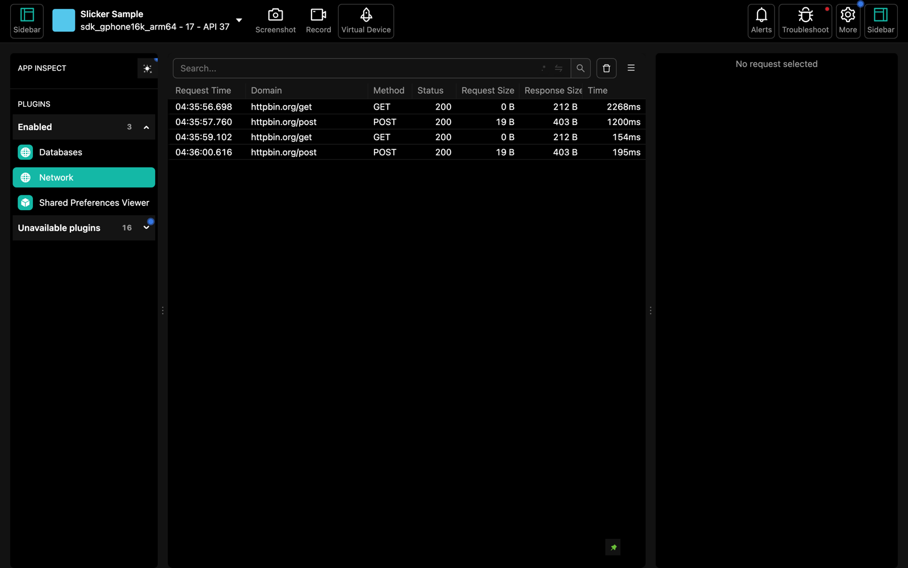
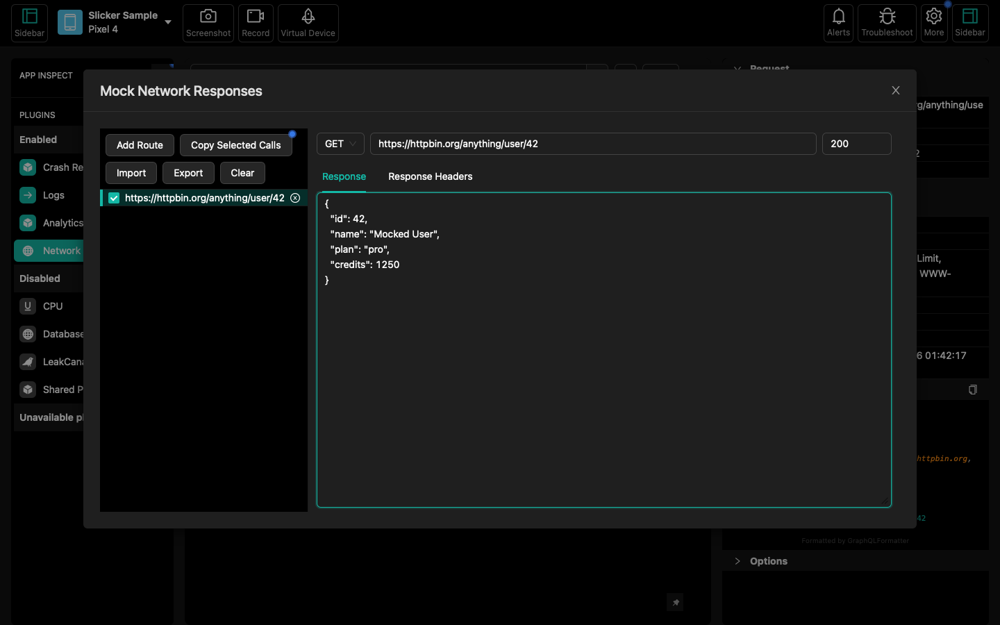
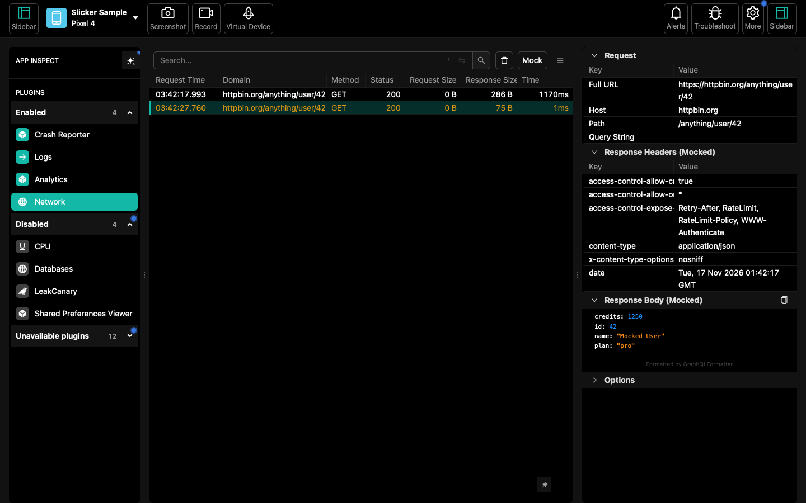
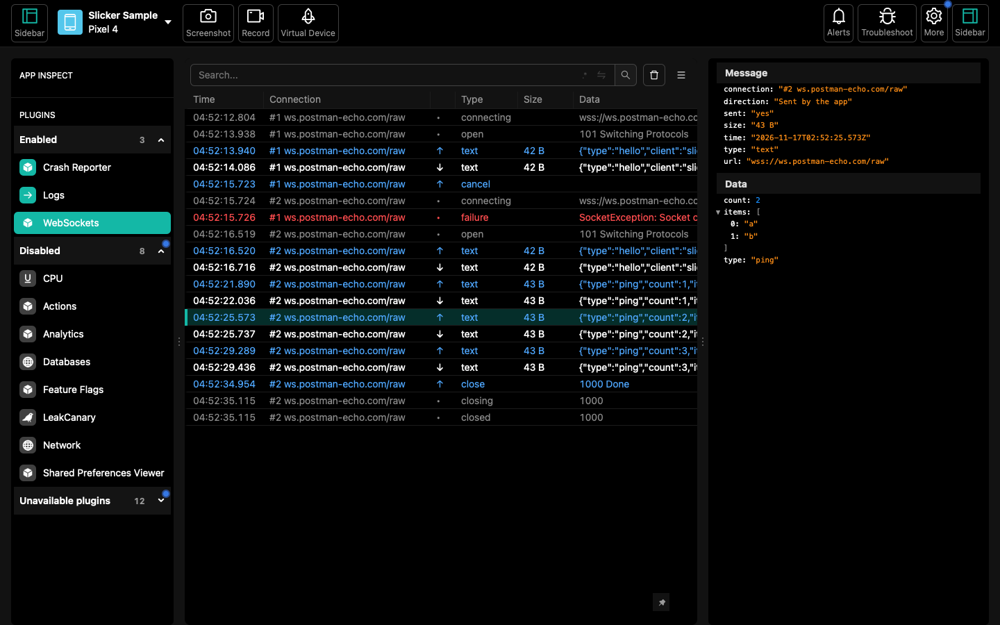
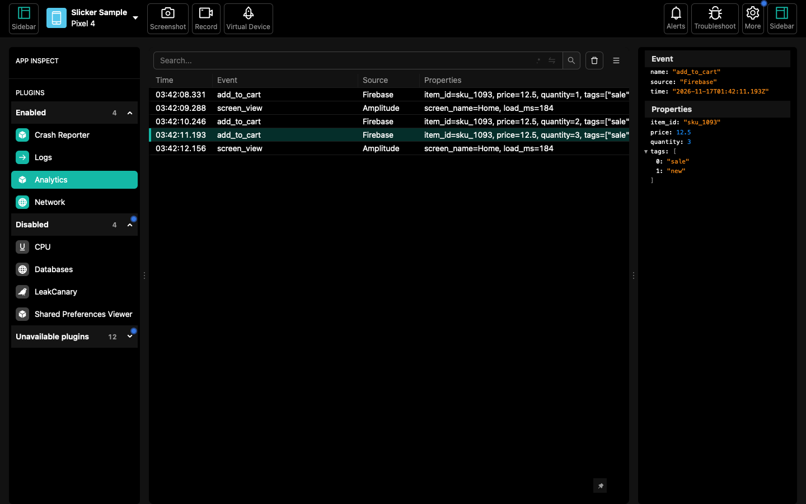
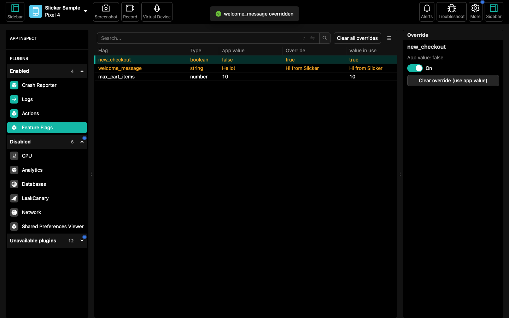
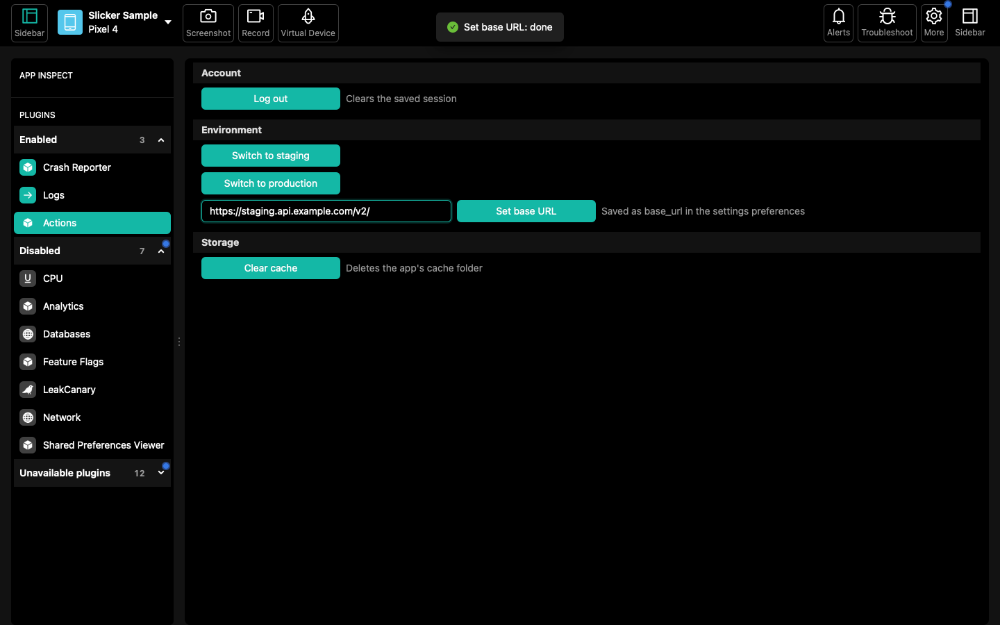
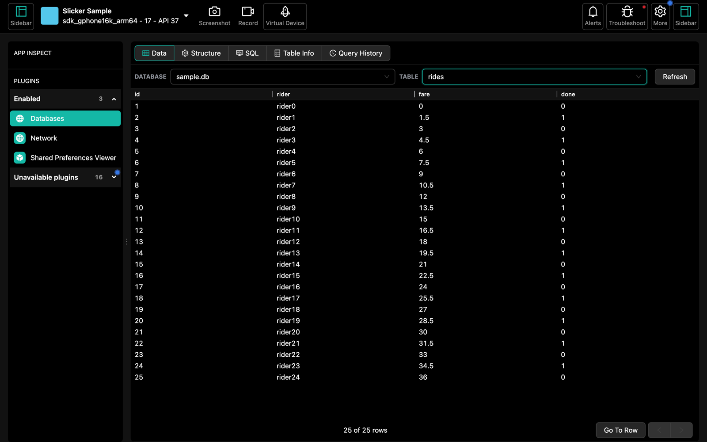
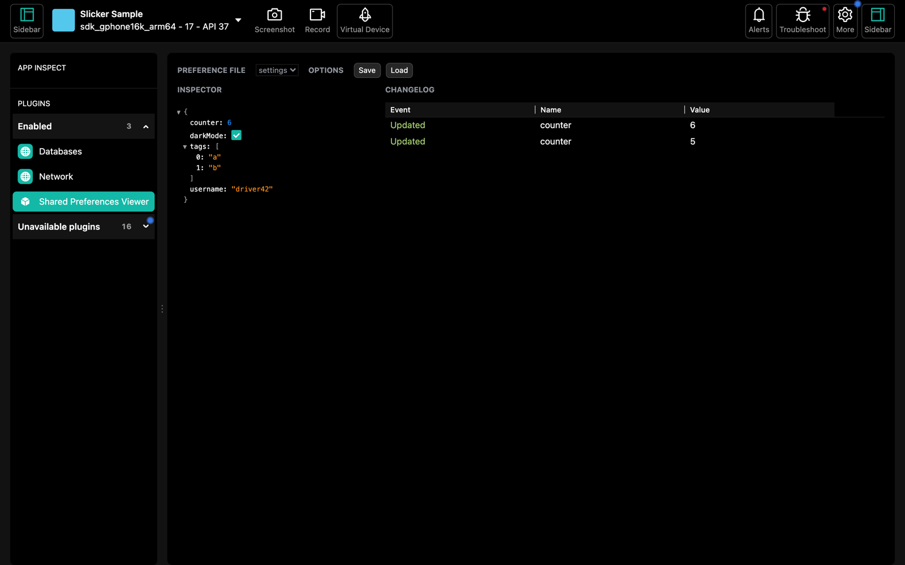
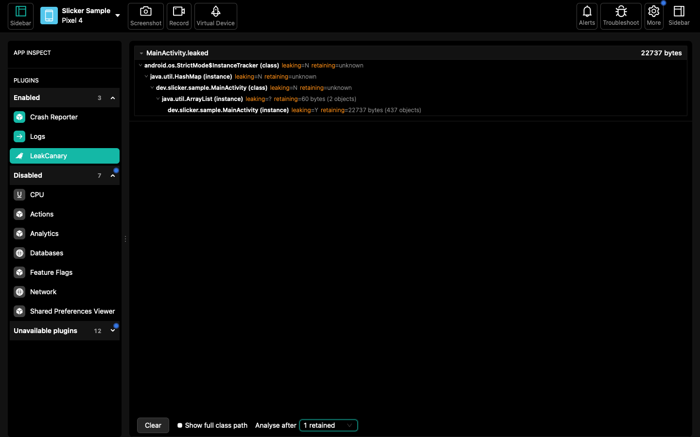

<p align="center">
  
</p>
<h1 align="center">Slicker</h1>
<p align="center">
  Network, analytics, feature flags, databases, leaks and more for Android apps, in one desktop window.
</p>
<p align="center">
  <a href="https://github.com/yehiahd/slicker/releases/latest"></a>
  <a href="https://jitpack.io/#yehiahd/slicker"></a>
</p>

---

Slicker is a lightweight debugging tool for Android. Your debug build connects to the Slicker
desktop app on your Mac, where you can inspect:

| Plugin | What you see |
|---|---|
| **Network** | Every OkHttp request and response: URL, method, status, headers, bodies, timing. Mock any response from the desktop |
| **WebSockets** | Every WebSocket connection (OkHttp or Socket.IO) and every message sent and received |
| **Analytics** | Live list of analytics events the app sends with `Slicker.logEvent`, with their properties |
| **Feature Flags** | Every flag the app reads with `Slicker.flag`, with its value; override any of them from the desktop |
| **Actions** | Buttons the app registers with `Slicker.addAction` (log out, clear cache, switch environment…); press one to run it on the device |
| **Databases** | All SQLite/Room databases: browse tables, structure, run SQL |
| **Shared Preferences** | All SharedPreferences files: view, edit, delete, live change log |
| **LeakCanary** | Memory leaks found by [LeakCanary](https://square.github.io/leakcanary/), with the reference chain. Bundled, no setup |
| **Crash Reporter** | Every crash on the device, with the stack trace (read from logcat over adb) |
| **Logs** | The device's logcat, searchable and filterable |

The Android library is pure Kotlin (no C++ or NDK) and needs no certificate setup. Release builds use
a no-op artifact, so nothing ships to users.

---

## Getting started, step by step

Follow these steps in order. They take about 10 minutes the first time.

### What you need

- A Mac with Apple Silicon (M1 or newer), macOS 12 or later.
- Android Studio, or at least the Android SDK platform-tools (`adb`). Slicker looks for `adb` in
  Android Studio's default location (`~/Library/Android/sdk`).
- An Android app that you build yourself and that uses OkHttp (directly or through Retrofit) for its
  network calls.
- An emulator, or a phone connected over USB with USB debugging turned on.

### Step 1: Install the desktop app

1. Open the [latest release](https://github.com/yehiahd/slicker/releases/latest) and download
   `Slicker-<version>-arm64.dmg` from **Assets**.
2. Open the DMG and drag **Slicker** into **Applications**.
3. The first time only: in Applications, right-click **Slicker**, choose **Open**, then **Open**
   again. The app is not notarized by Apple, so a plain double-click is blocked once. If macOS still
   refuses, go to System Settings → Privacy & Security and press **Open Anyway**.
4. A two-step setup wizard runs: pick **Android**, then press **Done** on the health check.

Slicker is a normal Mac app with its own window and Dock icon. Quitting it (Cmd+Q, or closing the
window) also stops its background server. Leave it open while you debug.

### Step 2: Add the JitPack repository

In your project's `settings.gradle.kts`:

```kotlin
dependencyResolutionManagement {
    repositories {
        google()
        mavenCentral()
        maven("https://jitpack.io")
    }
}
```

If your project lists repositories in the root `build.gradle` instead, add `maven { url "https://jitpack.io" }` there.

### Step 3: Add the library

In your app module's `build.gradle.kts`:

```kotlin
dependencies {
    debugImplementation("com.github.yehiahd.slicker:slicker:v0.1.3")
    releaseImplementation("com.github.yehiahd.slicker:slicker-noop:v0.1.3")
}
```

`slicker` is the real library, and `slicker-noop` has the same API but does nothing, so release builds
contain no inspector. If you have other build types (for example `staging`), give each one of the two,
such as `"stagingImplementation"("com.github.yehiahd.slicker:slicker:v0.1.3")`.

Check the [releases](https://github.com/yehiahd/slicker/releases) for a newer version tag.

### Step 4: Start Slicker when the app starts

In your `Application` class (create one and register it in the manifest with
`android:name=".MyApp"` if you don't have one):

```kotlin
import dev.slicker.Slicker

class MyApp : Application() {
    override fun onCreate() {
        super.onCreate()
        Slicker.start(this)
    }
}
```

This turns on all the plugins. Some work with no other setup (Databases, Shared Preferences,
LeakCanary, Crash Reporter, Logs); others need a line or two in your code. Each plugin's section under
[Plugins](#plugins) says what to add.

### Step 5: Allow the connection to the desktop

The app talks to Slicker over a plain (unencrypted) local connection to `localhost`. Android 9 and
later block that by default. Add a **debug-only** exception so release builds stay unchanged.

`app/src/debug/res/xml/network_security_config.xml`:

```xml
<?xml version="1.0" encoding="utf-8"?>
<network-security-config>
    <domain-config cleartextTrafficPermitted="true">
        <domain includeSubdomains="false">localhost</domain>
        <domain includeSubdomains="false">127.0.0.1</domain>
    </domain-config>
</network-security-config>
```

`app/src/debug/AndroidManifest.xml`:

```xml
<?xml version="1.0" encoding="utf-8"?>
<manifest xmlns:android="http://schemas.android.com/apk/res/android">
    <application android:networkSecurityConfig="@xml/network_security_config" />
</manifest>
```

Skip this step if your app already sets `android:usesCleartextTraffic="true"`. If your main manifest
already has a `networkSecurityConfig`, add the `localhost` domain to a debug copy of that file instead.

### Step 6: Run and enable the plugins

1. Make sure Slicker is open on your Mac.
2. Run the **debug** build on the emulator or USB phone. Slicker sets up the adb connection itself.
3. In logcat, filter by the tag `Slicker`. You should see `Connected to flipper-server at localhost:8333`.
4. In Slicker, click the device and app picker at the top left and choose your app **under your
   device's name**.
5. **Crash Reporter** and **Logs** are on by default. In the left sidebar, open **Disabled**, click **Network**, and press **Enable Plugin**. Do the
   same for the other plugins you want.

Plugins are enabled per app and per device, and Slicker remembers your choice. A new app, or the
same app on another device, starts with everything disabled.

### Step 7: Use the plugins

See [Plugins](#plugins) for what each one is for and how to use it.

#### Note on sensitive data

Slicker shows everything in full, including `Authorization` headers and cookies. That only happens in
debug builds, but keep it in mind when sharing screenshots.

---

## Plugins

Each plugin below says **why** you'd use it, **how to add** it to your app, and **how to use** it in
the desktop. Enable a plugin in the sidebar before using it (step 6).

### Network



**Why:** see exactly what your app sends and receives, without adding logs or a proxy. Use it to
check a request's URL, headers and body, see the server's real response when a screen shows the
wrong data, find slow or failing calls, and confirm which calls a screen makes.

**How to add:** add Slicker's interceptor to every `OkHttpClient` you want to see:

```kotlin
val client = OkHttpClient.Builder()
    .addInterceptor(Slicker.networkInterceptor())
    .build()
```

With Retrofit, pass that client to `Retrofit.Builder().client(client)`. With Hilt or Dagger, add the
interceptor where your network module builds the client, after your auth interceptor so you see the
final headers:

```kotlin
@Provides @Singleton
fun okHttp(): OkHttpClient = OkHttpClient.Builder()
    .addInterceptor(authInterceptor)
    .addInterceptor(Slicker.networkInterceptor())
    .build()
```

Requests sent through other HTTP stacks (HttpURLConnection, Ktor's non-OkHttp engines, image loaders
with their own client) do not show up. Most image loaders (Coil, Glide) can be given your OkHttp client.

**How to use:** use your app; every request appears as it happens. Click one to see headers and
bodies. Requests made while Network was disabled are not shown, so enable it first, then do the thing
you want to inspect.

#### Network mocking





**Why:** see how the app handles a response without changing the backend. The request never reaches
the server; the app gets the response you wrote. Use it to test error screens (500, 401, 404), edge
cases (empty lists, missing fields, long text), headers such as `Retry-After`, or to build a screen
before its endpoint exists.

**How to add:** nothing beyond the Network setup above.

**How to use:** press **Mock** above the request list.
- **Copy Selected Calls** starts from a real request you selected: its URL, method, status, body and
  headers are filled in, and you edit what you want to change.
- **Add Route** starts empty, for an endpoint that doesn't exist yet or that you can't trigger.
- **Response** is the body the app receives; **Response Headers** are the headers it receives.
- A route matches on method and URL. A `*` in the URL matches anything, and a URL without a query
  matches the same URL with any query.
- Mocked rows are orange. Untick a route to turn it off. Mocks stop when the desktop disconnects.
- **Export** saves your routes to a `.json` file; **Import** loads them back. Use it to share mock
  setups with QA or teammates, or to keep one file per test scenario.

### WebSockets



**Why:** WebSocket traffic (chat, live tracking, real-time updates, anything on Socket.IO) doesn't
show in the Network tab, and it's hard to debug from logs. Here you see every connection and every
message in order, both ways, with timing. Use it to check what the server pushes, confirm the app
sends the right payload, see why a connection drops, and find messages the app tried to send after
the socket closed.

**How to add:** create your sockets through `Slicker.webSocketFactory`, passing your OkHttpClient:

```kotlin
// Plain OkHttp
val socket = Slicker.webSocketFactory(client).newWebSocket(request, listener)

// Socket.IO (io.socket:socket.io-client)
val options = IO.Options().apply {
    webSocketFactory = Slicker.webSocketFactory(client)
    callFactory = client // with Slicker's interceptor, its HTTP polling shows in Network
}
val socket = IO.socket(url, options)
```

Everything else stays the same: your listener gets the same callbacks. Events from before the desktop
connects are kept and shown when it does. In release builds `webSocketFactory` returns your client
unchanged. Messages longer than 256 KB are cut.

**How to use:**
- Each row is a connection event (`•`: connecting, open, closing, closed, failure), a message the app
  sent (`↑`, blue) or a message it received (`↓`).
- **Connection** numbers each socket (`#1`, `#2`…); type `#1` in the search box to see one connection.
- Click a row for details: the full message (JSON is shown as a tree), its size, the handshake
  response headers for `open`, and the error for `failure`.
- Red rows are failures, and messages the app tried to send after the socket was already closed.
- The opening handshake is a normal HTTP request, so it also appears in **Network** (status 101).
  Messages and the close only appear here.

### Analytics



**Why:** check that the right events fire, at the right moment, with the right properties, while you
use the app, instead of waiting for them to show up in Firebase, Amplitude or another dashboard. Useful
when adding tracking, reviewing a tracking change, or helping QA verify an analytics spec.

**How to add:** call `Slicker.logEvent` next to your real tracking call, for example in your
analytics wrapper:

```kotlin
fun track(name: String, params: Map<String, Any?>) {
    firebaseAnalytics.logEvent(name, params.toBundle())
    Slicker.logEvent(name, params, source = "Firebase")
}
```

Properties can be strings, numbers, booleans, lists and maps; there is also an overload that takes a
`Bundle`. `source` is an optional label shown in its own column. Events sent before the desktop
connects are kept and delivered when it does. In release builds `logEvent` does nothing.

**How to use:** events appear as the app sends them. Click one to see its properties. Use the search
box to filter by name or property, and the bin button to clear the list.

### Feature Flags



**Why:** try every side of a flag without touching Remote Config, waiting for it to refresh, or
rebuilding. Use it to test a new flow before it's switched on, check what users see when a feature is
off, try different limits or copy, or let QA test both variants in a minute.

**How to add:** read each flag through `Slicker.flag`, passing the value your app would use. You get
that value back, unless you've overridden the flag on the desktop:

```kotlin
// With Firebase Remote Config (or any flag source)
val newCheckout = Slicker.flag("new_checkout", remoteConfig.getBoolean("new_checkout"))

// With a plain default
val maxItems = Slicker.flag("max_cart_items", 10)
```

Booleans, strings, ints, longs and doubles are supported. To react to an override without restarting
the screen, listen for changes:

```kotlin
Slicker.onFlagChanged { key -> if (key == "new_checkout") refreshCheckout() }
```

In release builds `flag` just returns the value you passed in.

**How to use:** a flag appears the first time the app reads it. Click it to override it: a switch for
booleans, a text box for the rest. Overridden flags are orange, and overrides are saved on the device
so they survive app restarts. **Clear override** goes back to the app's value; **Clear all overrides**
resets everything.

### Actions



**Why:** many test setups take several taps or a reinstall: logging out, clearing a cache, switching
to staging, pointing the app at a custom server, seeding test data. With actions each is one click on
the desktop. Handy for QA, and for getting the app into a specific state before a test.

**How to add:** register buttons with the code to run. It runs on the main thread:

```kotlin
Slicker.addAction("Log out", group = "Account") { session.logout() }
Slicker.addAction("Clear cache", group = "Storage", description = "Deletes cached images") {
    imageLoader.clearCache()
}
```

Add `input` for a button with a text field; your code gets what was typed:

```kotlin
Slicker.addAction("Set base URL", group = "Environment", input = config.baseUrl) { url ->
    config.setBaseUrl(url)
}
```

Register them from your `Application` (or wherever the objects they use live). Adding an action with
the same name replaces it; `Slicker.removeAction(name)` removes it. In release builds they do nothing.

**How to use:** press a button to run it on the device; type in the text field first for actions that
have one (Enter also runs it). A message shows whether it worked, or the error if your code threw.

### Databases



**Why:** look inside the app's SQLite and Room databases without pulling files off the device. Check
what was saved, debug a migration, or run a quick query to find bad data.

**How to add:** nothing. Every database in the app's `databases/` folder is found automatically.

**How to use:** pick a database and a table to browse rows, see the structure, or run SQL in the
query tab.

### Shared Preferences



**Why:** see and change what the app stored, live. Flip a setting, fake an onboarding state or reset
a "seen" flag without clearing all app data, and watch what the app writes as you use it.

**How to add:** nothing. Every file in `shared_prefs/` is found automatically.

**How to use:** open **Shared Preferences Viewer** and pick a file. Click a value to edit it; changes
the app makes appear in the change log below.

### LeakCanary



**Why:** find memory leaks (screens, views or objects kept alive after they should be gone), which
cause slowdowns and out-of-memory crashes. Slicker shows LeakCanary's results on the desktop, with the
chain of references that keeps each object alive, so you can see which field to fix.

**How to add:** nothing. The debug artifact includes [LeakCanary](https://square.github.io/leakcanary/).
LeakCanary adds its own "Leaks" launcher icon and notifications on the device. If your app already
uses LeakCanary, keep it; Slicker picks it up. To turn leak detection off, exclude it:

```kotlin
debugImplementation("com.github.yehiahd.slicker:slicker:v0.1.3") {
    exclude(group = "com.squareup.leakcanary")
}
```

**How to use:** leaks appear after LeakCanary analyses the heap. While the app is on screen it waits
for 5 retained objects (LeakCanary's default), because the analysis freezes the app for a few
seconds; in the background it analyses after 1. Change the number with **Analyse after** at the
bottom of the tab; the app remembers it.

Slicker stores LeakCanary's heap dumps in the app's private cache instead of the public `Download`
folder LeakCanary picks by default. Shared storage is slow on many devices (on a Pixel 4 a 30 MB dump
never finished); private storage writes it in about a second.

### Crash Reporter

**Why:** see every crash with its full stack trace as it happens, even when the app restarts straight
away and logcat has scrolled past it.

**How to add:** nothing. Slicker reads crashes from the device's logcat over adb.

**How to use:** on by default. Each crash shows its exception and stack trace.

### Logs

**Why:** read the device's logcat next to your other tools, with search and filters, without Android
Studio open.

**How to add:** nothing. It reads logcat over adb.

**How to use:** on by default. Filter by level, tag or text.

---

## Troubleshooting

| Symptom | Fix |
|---|---|
| App not in the picker | Check logcat (tag `Slicker`). Make sure Slicker is open, then relaunch the app. `adb reverse --list` should show `tcp:8333`. |
| `CLEARTEXT communication to localhost not permitted` in logcat | Do step 5. |
| App is listed but Network is empty | Network is disabled for that app on that device (step 6), or the app made no requests yet. Many apps load from cache on launch; do something that fetches new data. |
| Some requests are missing | That client doesn't have `Slicker.networkInterceptor()` (see [Network](#network)), or the call doesn't use OkHttp. |
| Two entries for the same phone | One is the adb device, the other is the app connection. Choose the one that lists your app. |
| Can't install the debug build over a Play Store build | Signatures differ. Uninstall the Play Store build first (this deletes the app's data on that device). |
| Nothing in a release build | By design: release uses `slicker-noop`. |
| Slicker window stays on "Starting Slicker…" | Check `~/Library/Logs/Slicker/server.log`. Another Slicker or Flipper may be using port 52342; quit it and reopen Slicker. |

More detail, configuration options and a local build of the library:
[slicker-android/README.md](slicker-android/README.md).

---

## Building from source

**Desktop, run from source** (needs Node or `npx`): `./scripts/slicker-desktop.sh`. It opens the UI in
your browser at http://localhost:52342.

**Mac app (DMG):**

```bash
./scripts/slicker-dmg.sh
```

Produces `dist/Slicker-<version>-arm64.dmg` (about 115 MB, includes its own Node runtime). The app is
ad-hoc signed, not notarized. Needs the Xcode command line tools (`xcode-select --install`): the build
compiles the native window app from `desktop/static/slicker-mac/main.swift` with `swiftc`.

**Releasing:** push a `v*` tag, which JitPack uses for the library, then create a GitHub release for
that tag and attach the DMG.

## Ideas and future plugins

See [TODO.md](TODO.md).

## Repository layout

```
slicker-android/   Android library (slicker, slicker-noop) and a sample app
desktop/           Desktop app: server, web UI, native Mac app (static/slicker-mac)
scripts/           slicker-desktop.sh (run from source), slicker-dmg.sh (build the Mac app)
SLICKER_NOTES.md   Protocol notes
```

The `android/`, `iOS/`, `xplat/`, `react-native/` and `docs/` folders come from Flipper and are not
used by Slicker.

## Credits and license

Slicker is a fork of [Flipper](https://github.com/facebook/flipper) by Meta, which was archived. The
desktop is Flipper's, rebranded for Slicker; the Android client is a new
implementation of Flipper's protocol.

Released under the MIT license, the same as Flipper. See [LICENSE](LICENSE).
